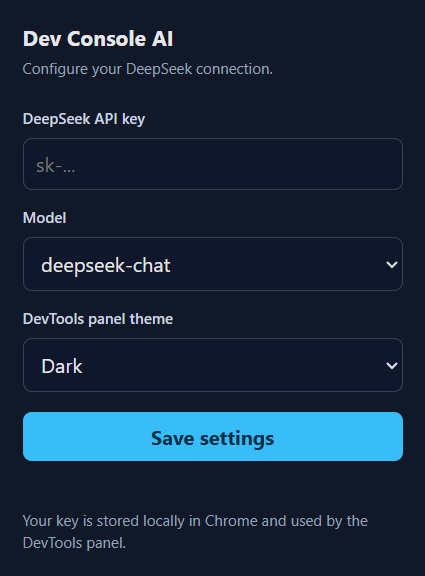
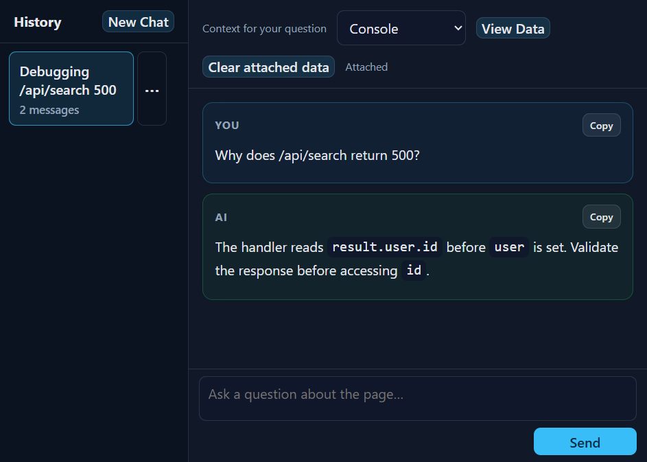

# Dev Console AI

A Chrome extension that adds a dedicated DevTools panel for AI-assisted debugging.

Features:
- Dedicated DevTools panel with UI
- Toolbar popup for configuring the DeepSeek API key and model
- Choose a light, dark, or system-matched DevTools panel theme from the toolbar popup
- Captures page console, network, and metadata; interactively select and highlight a DOM element to attach its markup
- Chat UI with automatic capture when selecting a source; console data updates live while selected, and network data refreshes as requests finish. DOM context uses the selected element snapshot, while context is also refreshed on send. Inspect attached data in a compact modal.
- Clear attached context at any time, or select another DOM element without changing the context source.
- Capture DOM through the visual picker or reuse the currently selected node in Chrome’s Elements panel.
- New chats get a separate AI-generated title (up to 180 characters); rename or delete a chat from its three-dot history menu. Deleting a chat asks for confirmation.
- AI requests include the active conversation history, including previously attached context.
- Markdown rendering with HTML tables and per-table CSV or Excel (.xlsx) export
- Copy-to-clipboard support for chat responses
- Conversation history saved locally
- DeepSeek API integration

## Screenshots

### Toolbar popup

### DevTools chat panel

## Project structure
- `manifest.json` — extension manifest
- `devtools.html` — DevTools panel UI
- `devtools.css` — styling
- `devtools.js` — panel logic and DeepSeek calls
- `popup.html`, `popup.css`, `popup.js` — toolbar settings popup

## Load the extension in Chrome
1. Open `chrome://extensions` in Chrome.
2. Enable Developer mode.
3. Click Load unpacked.
4. Select this project folder.
5. Reload the page with DevTools closed, then open DevTools on any page.
6. Select the `Dev Console AI` tab. If it is not visible, use the `»` overflow menu in the DevTools tab bar.

The extension registers the panel from `devtools.html` and renders its UI from `panel.html`. After changing extension files, click Reload on the extension card in `chrome://extensions`, then close and reopen DevTools.

## Notes
- Click the extension icon in Chrome's toolbar to set your DeepSeek API key, model, and DevTools panel theme, then click **Save settings**. Settings are shared with the DevTools panel.
- Console capture starts when the DevTools panel opens, so it includes new messages but not earlier console history. Chrome may omit some network requests made before DevTools opened; reload the page to capture a complete network log.
- For precise DOM capture, select a node in Chrome’s Elements panel and return to Dev Console AI; it captures the selection automatically. The visual picker remains available without switching tabs.
- The extension stores settings and chat history in `chrome.storage.local`.
- The app uses the DeepSeek Chat Completions API at `https://api.deepseek.com/v1/chat/completions`.
